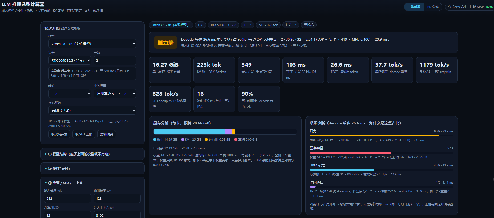
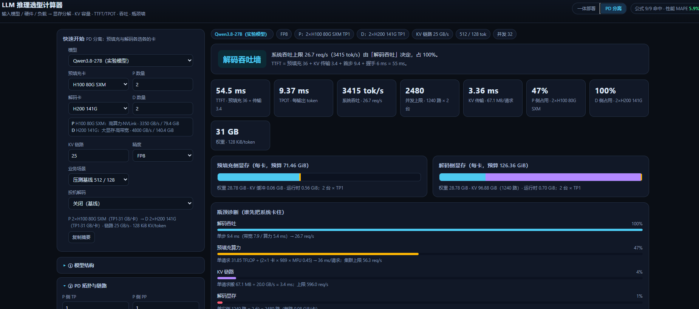

# LLM Inference Sizing Calculator

**[简体中文](README.md)** | English

> Feed it a model, some GPUs, and a workload — it returns VRAM, KV cache, TTFT/TPOT, throughput, and tells you which wall you hit first.

A single-file, zero-dependency, offline-ready HTML tool. Two modes: **monolithic serving** and **PD disaggregation** (separate prefill/decode clusters, heterogeneous GPUs allowed).

**Live demo**: https://lichen9240-creator.github.io/llm-sizing-calculator/

---

## Screenshots

**Monolithic**: pick model / GPU / workload on the left, get the memory breakdown, the four bottleneck shares, and every formula with numbers plugged in.



**PD disaggregation**: prefill and decode run on different cards (here P 2×H100 + D 2×H200), with KV transfer time, per-side capacity ceilings and the P:D ratio.



---

## Why

The three questions that come up in every sizing meeting: *Will it fit? How many concurrent users? Is it memory-bound or bandwidth-bound?*

- Params ÷ VRAM misses the KV cache — at long context it can dwarf the weights.
- Nameplate FLOPS misses the fact that decode is bandwidth-bound.
- Commercial capacity planners are black boxes.

This tool shows every step: **formula, substituted values, verdict** — all on screen.

---

## What it computes

| Area | Metrics |
|---|---|
| Memory | weights / KV cache / runtime (CUDA Graph + workspace) / draft model / leftover for the KV pool |
| Capacity | KV bytes per token, KV pool tokens, max concurrency at current and max context |
| Latency | TTFT (prefill compute + queueing), TPOT, end-to-end, P95 queueing estimate |
| Throughput | per-stream tok/s, system tok/s, req/min, SLO goodput, saturation batch B\* |
| Bottleneck | VRAM wall / HBM bandwidth wall / compute wall / interconnect wall, with the numbers behind each |
| Speculative decoding | MTP, Medusa, EAGLE-3, DFlash2, DSpark, NGRAM, SUFFIX, folded in via acceptance length E |
| PD | per-side capacity ceilings, KV transfer time, P:D ratio hint, link wall |

---

## The two modes

### Monolithic

```
TPOT = max((weights + KV bytes) ÷ bandwidth, 2·P_act·B ÷ FLOPS) + comm + fixed
```

The UI reports "bandwidth 88% / compute 33%" for the decode step, plus numerator and denominator for each term.

### PD disaggregation

```
t_pre   = (2·P_act·S_in + 2·L·S_in²·n_h·d_h) ÷ (TP_p × FLOPS × MFU)
t_xfer  = S_in × KV/token ÷ (link bandwidth × efficiency)
TTFT    = t_pre + t_xfer + first step + handoff
throughput = min(R_pre, R_dec, R_link)
```

Whichever ceiling is lowest is your wall. An imbalanced cluster gets flagged ("P side at 47%, D side at 100% — add decode cards").

---

## Model coverage

34 open models, architecture values taken from public configs:

- **2026 flagships**: DeepSeek-V4.1-Flash / 1017, GLM-5.3 / 5.2 / 5.3-Flash, MiniMax-M3.1-Flash, Kimi-K3
- **Dense**: Qwen3-1.7B…32B, Qwen2.5-7B/32B/72B, Llama-3.1-8B / 3.3-70B, Gemma-3, Mistral, Phi-4, Yi-34B
- **MoE**: Qwen3-30B-A3B / 235B-A22B, Mixtral-8x7B/8x22B, GLM-4.5 / Air, DeepSeek-V2/V3, Kimi-K2

Hybrid attention (CSA2 shared KV, KDA linear attention, MSA sparse attention) is handled with an explicit "KV bytes/token" override taken from the official numbers, instead of forcing the GQA formula.

---

## Validation

A reproducible regression suite (`node validation/validate.mjs`) checks three things:

**1. Formula accuracy** (against papers / vendor logs)

| Item | Computed | Reference | Error |
|---|---|---|---|
| KV/token (27B-FP8) | 128 KiB | vLLM log: 221,184 tok ↔ 27.0 GiB | 0.0% |
| KV pool size | 223.4k tok | vLLM log: 221,184 | 1.1% |
| MLA KV/token (DeepSeek-V2) | 70.27 KB | paper ~70 KB | 0.4% |
| DeepSeek-V4.1 global KV | 890 B | official model card | 0.0% |
| Kimi-K3 KV | 13,824 B | 24 MLA layers × (512+64) × fp8 | 0.0% |
| Llama-3-70B weights | 141.2 GB | 70.6B × 2B | 0.1% |
| H100 ridge point | 295.2 FLOP/B | 989 TFLOPS ÷ 3.35 TB/s | 0.1% |

**2. Performance regression** (real benchmark: Qwen3.8-27B-FP8 on 2×RTX 5090)

MAPE **7.3%** across 7 measured points; the largest deviation is at high concurrency, where scheduling and queueing dominate.

**3. PD self-checks**

| Check | Result |
|---|---|
| With infinite link, TTFT = monolithic + one decode step + handoff | 0.0% deviation |
| A 2 GB/s link must be reported as the KV link wall | detected |
| KV transfer time = S_in·KV/tok ÷ link | 327.7 vs 327.7 ms |
| Prefill ceiling = N·TP·FLOPS·MFU ÷ 2P ÷ S_in | 6.78 vs 6.79 req/s |

The PD decomposition follows [DistServe (OSDI'24)](https://www.usenix.org/conference/osdi24/presentation/zhong-yinmin), [Splitwise (ISCA'24)](https://ieeexplore.ieee.org/document/10609649) and Mooncake (FAST'25): TTFT and TPOT decouple, the two phases can run on different hardware, and KV transfer is the price you pay.

---

## Quick start

1. Download `index.html` and open it in a browser — no server, no network needed.
2. Pick a model, a GPU, a workload; results appear instantly.
3. For your own cluster, calibrate MFU / bandwidth efficiency / fixed overhead once in "⑤ 校准系数", then reuse.

Run the checks only:

```bash
node validation/validate.mjs
```

---

## Layout

```
index.html                     # the calculator (single file, includes PD mode)
images/                        # screenshots
validation/validate.mjs        # regression suite (formulas / measurements / PD checks)
validation/report.md           # generated report
```

---

## Further reading: PD disaggregation & serving schedulers

Every assumption in the tool traces back to a paper or an open-source implementation.

### Papers

| Paper | Venue | How it maps to this tool |
|---|---|---|
| [DistServe: Disaggregating Prefill and Decoding](https://arxiv.org/abs/2401.09670) | OSDI'24 | The canonical PD split: optimises for goodput rather than peak throughput — the origin of "TTFT and TPOT decouple" |
| [Splitwise: Efficient Generative LLM Inference Using Phase Splitting](https://arxiv.org/abs/2311.18677) | ISCA'24 | Prefill and decode want different hardware (compute vs bandwidth) — the basis for heterogeneous GPU selection |
| [Mooncake: A KVCache-centric Disaggregated Architecture](https://arxiv.org/abs/2407.00079) | FAST'25 | Treats KV transfer and reuse as first-class citizens — the KV link capacity and transfer time in the tool |
| [Llumnix: Dynamic Scheduling for LLM Serving](https://arxiv.org/abs/2406.03243) | OSDI'24 | Cross-instance rescheduling for load skew, i.e. what happens when the tool's static P:D ratio breaks |
| [Sarathi-Serve: Chunked Prefills and Stall-Free Batching](https://arxiv.org/abs/2403.02310) | OSDI'24 | The original analysis of "prefill steals decode" — the queueing factor and chunked prefill |
| [vLLM / PagedAttention](https://arxiv.org/abs/2309.06180) | SOSP'23 | Paged KV and continuous batching — where the KV pool and max-concurrency numbers come from |
| [SGLang / RadixAttention](https://arxiv.org/abs/2312.07104) | NeurIPS'24 | Prefix-tree KV reuse — the "prefix hit rate" input field |
| [AlpaServe: Statistical Multiplexing with Model Parallelism](https://arxiv.org/abs/2302.11665) | NSDI'24 | How to split parallelism when many models share a cluster |
| [MuxServe: Flexible Spatial-Temporal Multiplexing for Multiple LLM Serving](https://arxiv.org/abs/2404.02015) | ICML'24 | Co-locating multiple models on the same GPUs — relevant once one cluster serves several models |
| [Parrot: Efficient Serving of LLM-based Applications](https://arxiv.org/abs/2405.19888) | OSDI'24 | Request-level dependencies (Agent / RAG chains) and semantic scheduling |

### Open-source implementations

| Project | What to look at |
|---|---|
| [vLLM](https://github.com/vllm-project/vllm) | Production engine; ships a disaggregated-prefill example |
| [SGLang](https://github.com/sgl-project/sglang) | Official prefill/decode disaggregation and RadixAttention |
| [NVIDIA Dynamo](https://github.com/ai-dynamo/dynamo) | Datacenter-scale inference framework with PD split and KV-aware routing |
| [llm-d](https://github.com/llm-d/llm-d) | Kubernetes-native distributed inference on top of vLLM |
| [Mooncake](https://github.com/kvcache-ai/Mooncake) | Industrial KV cache transfer / pooling |
| [DistServe](https://github.com/LLMServe/DistServe) | Authors' reference implementation |
| [TensorRT-LLM](https://github.com/NVIDIA/TensorRT-LLM) | NVIDIA's high-performance stack with in-flight batching |
| [vLLM production-stack](https://github.com/vllm-project/production-stack) | Reference deployment stack with KV-aware routing |

> Suggested order: DistServe for *why split*, Splitwise for *how to pick cards*, Mooncake and llm-d for *how it lands in a real cluster*, Sarathi-Serve for *what goes wrong when you don't split*.

---

## Known limitations

- Performance numbers depend on three empirical coefficients (MFU, bandwidth efficiency, fixed overhead); expect 10–20% absolute error. Capacity numbers (weights, KV, concurrency) are deterministic formulas accurate to <2%.
- Scheduler gains are not modelled: KV-aware routing, prefix caching and layered PD transfer are excluded, so PD results are conservative.
- Sparse attention FLOPs are approximated with an attention window; TTFT beyond 64K context is conservative.

---

## License

[MIT](LICENSE)
