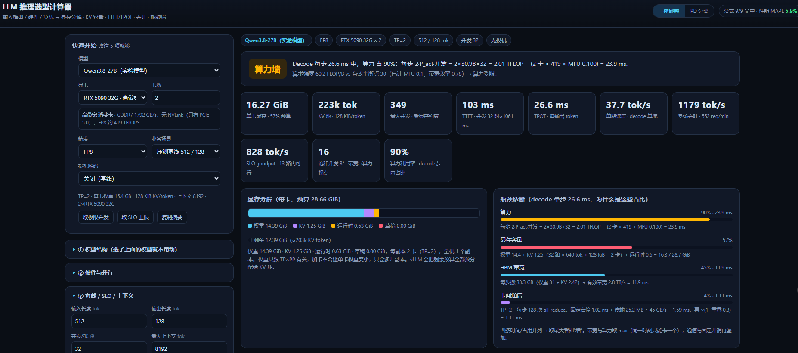
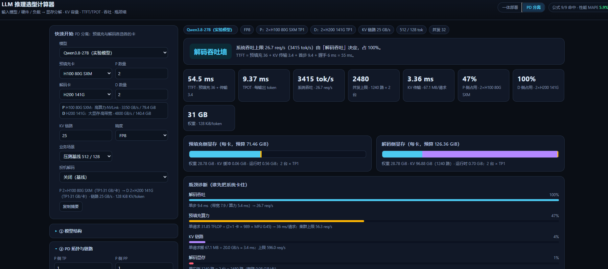

# LLM 推理选型计算器

简体中文 | **[English](README.en.md)**

> 输入模型、硬件、负载，立刻算出显存、KV、TTFT/TPOT、吞吐，并告诉你卡在哪面墙。

单文件、零依赖、离线可用的 HTML 工具，支持**一体部署**与 **PD 分离（Prefill / Decode 拆开 + 异构选卡）**。

**在线体验**：https://lichen9240-creator.github.io/llm-sizing-calculator/

---

## 界面预览

**一体部署**：左边选模型 / 卡 / 场景，右边直接给出显存分解、四类瓶颈占比与每条公式的代入值。



**PD 分离**：预填充与解码各选各的卡（这里是 P 2×H100 + D 2×H200），额外算出 KV 传输耗时、两侧各自的容量上限与配比。



---

## 为什么做这个

选型会上最常见的问题是：「这张卡放得下吗？能扛多少并发？先撞显存还是先撞带宽？」

- 只看参数量除以显存，会漏掉 KV Cache —— 长上下文下它比权重还大；
- 只看厂商标称 FLOPS，会漏掉 decode 阶段其实是带宽瓶颈；
- 商业容量规划工具是黑盒，说不清每个数字怎么来的。

这个工具把每一笔账都摊开：**公式、代入值、判定依据**，全部显示在界面上。

---

## 能算什么

| 分类 | 指标 |
|---|---|
| 显存 | 权重 / KV Cache / 运行时（CUDA Graph + workspace）/ 投机草稿 / 剩余可做 KV 池的量 |
| 容量 | 每 token KV 字节数、KV 池 token 数、按当前上下文与满上下文的最大并发 |
| 延迟 | TTFT（含 prefill 计算与排队）、TPOT、端到端、P95 视角的排队估算 |
| 吞吐 | 单路 tok/s、系统 tok/s、req/min、SLO 内 goodput、饱和并发 B\* |
| 瓶颈 | 显存墙 / HBM 带宽墙 / 算力墙 / 卡间通信墙，附四条公式的代入值 |
| 投机解码 | MTP、Medusa、EAGLE-3、DFlash2、DSpark、NGRAM、SUFFIX，按 E 折算加速 |
| PD 分离 | 预填充/解码两侧各自的容量上限、KV 传输耗时、P:D 配比建议、链路墙 |

---

## 两种模式

### 一体部署

一张图看清 decode 单步的四个时间分量：

```
TPOT = max(权重 + KV 字节 ÷ 带宽, 2·P_act·B ÷ 算力) + 通信 + 固定开销
```

界面上直接给出「带宽 88% / 算力 33%」这样的占比，以及每一行的分母分子。

### PD 分离

预填充和解码各选各的卡（例如 P 侧 H100、D 侧 H200），中间多一段 KV 搬运：

```
t_pre   = (2·P_act·S_in + 2·L·S_in²·n_h·d_h) ÷ (TP_p × FLOPS × MFU)
t_xfer  = S_in × KV/token ÷ (链路带宽 × 效率)
TTFT    = t_pre + t_xfer + 首步 + 握手
系统吞吐 = min(R_pre, R_dec, R_link)
```

三条上限哪个最小，哪条就是墙。配比失衡时会提示「P 侧 47% / D 侧 100%，该给 D 加卡」。

---

## 覆盖的模型

内置 34 个开源模型，结构参数取自公开 config：

- **2026 旗舰**：DeepSeek-V4.1-Flash / 1017、GLM-5.3 / 5.2 / 5.3-Flash、MiniMax-M3.1-Flash、Kimi-K3
- **稠密**：Qwen3-1.7B ~ 32B、Qwen2.5-7B/32B/72B、Llama-3.1-8B / 3.3-70B、Gemma-3、Mistral、Phi-4、Yi-34B
- **MoE**：Qwen3-30B-A3B / 235B-A22B、Mixtral-8x7B/8x22B、GLM-4.5 / Air、DeepSeek-V2/V3、Kimi-K2

混合注意力（CSA2 共享 KV、KDA 线性注意力、MSA 稀疏注意力）用「KV/token 覆盖」字段按官方口径填，而不是硬套 GQA 公式。

---

## 验证

工具有一套可复跑的回归测试（`node validation/validate.mjs`），校验三类东西：

**① 公式精度**（对照论文 / 厂商日志）

| 条目 | 计算 | 参考 | 误差 |
|---|---|---|---|
| KV/token（27B-FP8） | 128 KiB | vLLM 日志 221,184 tok ↔ 27.0 GiB | 0.0% |
| KV 池容量 | 223.4k tok | vLLM 日志 221,184 | 1.1% |
| MLA KV/token（DeepSeek-V2） | 70.27 KB | 论文 ~70 KB | 0.4% |
| DeepSeek-V4.1 全局 KV | 890 B | 官方模型卡 | 0.0% |
| Kimi-K3 KV | 13,824 B | 24 层 MLA × (512+64) × fp8 | 0.0% |
| Llama-3-70B 权重 | 141.2 GB | 70.6B × 2B | 0.1% |
| H100 机器平衡点 | 295.2 FLOP/B | 989 TFLOPS ÷ 3.35 TB/s | 0.1% |

**② 性能回归**（真实压测：Qwen3.8-27B-FP8 × 2×RTX5090）

7 个实测点 MAPE **7.3%**，最大偏差出现在高并发（调度与队列占比上升）。

**③ PD 自检**

| 检查 | 结果 |
|---|---|
| 链路→∞ 时 TTFT = 一体 + 一个解码步 + 握手 | 偏差 0.0% |
| 2 GB/s 链路应判为 KV 链路墙 | 正确识别 |
| KV 传输时间 = S_in·KV/tok ÷ 链路 | 327.7 vs 327.7 ms |
| 预填充上限 = N·TP·FLOPS·MFU ÷ 2P ÷ S_in | 6.78 vs 6.79 req/s |

PD 的拆分方式与 [DistServe (OSDI'24)](https://www.usenix.org/conference/osdi24/presentation/zhong-yinmin)、[Splitwise (ISCA'24)](https://ieeexplore.ieee.org/document/10609649)、Mooncake (FAST'25) 一致：TTFT 与 TPOT 解耦、两侧可用不同硬件、KV 传输是主要代价。

---

## 快速开始

1. 下载 `index.html`，双击用浏览器打开（无需服务器、无需联网）。
2. 顶部选模型 → 选卡 → 选场景，右侧立刻出结果。
3. 换成自己的机器时，在「⑤ 校准系数」里把 MFU / 带宽效率 / 固定开销反推校准一次，之后就能算任意配置。

只想跑校验：

```bash
node validation/validate.mjs
```

---

## 仓库结构

```
index.html                     # 计算器本体（单文件，含 PD 模式）
images/                        # 界面截图
validation/validate.mjs        # 回归脚本（公式 / 实测 / PD 自检）
validation/report.md           # 生成的校验报告
```

---

## 已知局限

- 性能类指标依赖三个经验系数（MFU、带宽效率、固定开销），绝对值误差 10–20%；容量类（权重、KV、并发上限）是确定性公式，误差 <2%。
- 不含调度器收益：KV-aware 路由、前缀缓存复用、PD 的分层流水线传输都没有建模，因此 PD 结果是偏保守的。
- 稀疏注意力的 FLOPs 用「注意力窗口」近似，超长上下文（>64K）的 TTFT 会偏保守。

---

## License

[MIT](LICENSE)
